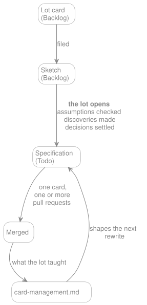
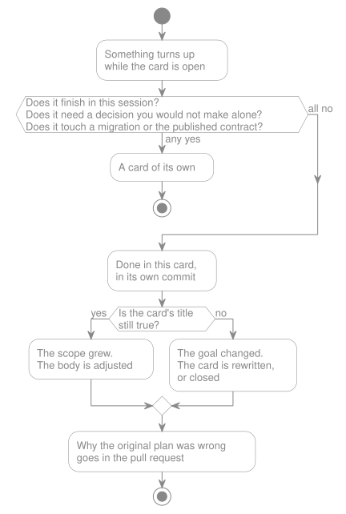

# Card Management

> **In brief**
>
> - A card is a change that can merge into `main` on its own and leave it stable, tested and documented.
> - A lot exists before its cards, as a lot card in `Backlog`, and its cards are cut when it opens: a `Backlog` card is
>   a sketch, a `Todo` card is a specification, and moving one between them is the rewrite rather than a drag.
> - A `Todo` card has nothing left open: no assumption, no discovery, no open decision. What was settled is written in
>   its `Decisions`, and that is what makes it ready for an agent.
> - Size is a target, not a measurement: a pull request somebody reviews in one sitting. Under roughly four files, ask
>   whether it is a card at all; past roughly four hundred added lines, ask what else got in.
> - Three tests, in the order they catch things: does it cost more to file than to do, does its title need "and", does
>   one of its decisions take work to settle. A decision that only needs an answer is settled before `Todo` instead.
> - Adjacent work found while a card is open is done inside it, in its own commit, not filed as a card of its own. Clean
>   scope protects the reviewer, so the split is decided once, when the pull request opens.
> - A card is a hypothesis. If its title is still true the scope simply grew; if it is not, the card is rewritten. The
>   divergence is written in the pull request, and only when the original plan was wrong.
> - The template is the [issue form](https://github.com/Gcob/lara-spec-first/blob/main/.github/ISSUE_TEMPLATE/task.md).
>   This file is where its reasoning lives.
> - `Status` moves with the work; `Phase` and `Kind` are set at triage and `Lot` when that lot is cut. The board keeps
>   each of them, and a card's body carries one only until it gets there. `Order` is the queue, and `Milestone` is the
>   release a card ships in.
> - A card past `Backlog` has a milestone, since no milestone means not planned. A gap that waits with its reason and
>   its triggers carries the `edge-case` label and no release milestone.
> - `just status` prints what is in flight, what comes next and the next release, from the board, GitHub and git, and
>   flags every place where they disagree. It only reads, so run it before asking what to work on.

Three lots have been cut so far, and each one needed a review to find the same two failures: a card small enough to be a
checkbox on another one, and a card large enough to be a lot. This file exists so that the next lot does not pay for
that review again.

## A card is a vertical slice

**A card is a change that can merge into `main` on its own and leave it stable, tested and documented.** That is the
whole definition, and everything below follows from it.

It is never "the emitter", then "its tests", then "its documentation". The
[three-places rule](../../AGENTS.md#every-change-lands-in-three-places) already forbids splitting those apart, so a card
that proposes it is asking for permission to ship something incomplete. When a change is genuinely too large, split it
the other way: the happy path first and the edge cases second, or one command flag at a time. Both leave each half
shippable.

## Cards are cut when the lot opens, not before

**A lot exists from the day the phase is planned, as a [card of its own](#a-lot-has-a-card-of-its-own) sitting in
`Backlog`. The cards inside it are written just before that lot opens.** This file leans on the rule twice already, once
to defer [#40](https://github.com/Gcob/lara-spec-first/issues/40)'s split and once to explain a card with no `Lot`, so
it is worth stating as a rule rather than leaving as an excuse.

The reason is that a card written six months early is written against a tree, a design and a set of decisions that have
all moved by the time somebody picks it up. Lot 0 paid for that in full: its cards were written in one sitting before
any of the work was understood, and every one of them had to be reworded mid-flight, not because the work changed but
because the card had guessed at how the work would be described.

**Which is what the `Status` column actually says: how settled a card is, not only where it sits.** A `Backlog` card is
a sketch. It records that something is coming and roughly what, and reading it as though it were settled is the mistake
this rule prevents. A `Todo` card is a specification: its lot has been cut, so it was rewritten against the tree as it
stands now.

**Opening a lot starts with its own card, not with its cards.** The lot card was sketched as early as any other, so it
is questioned again first: what it assumed is checked, what it did not know is found out or turned into a `Decision`
card, and whatever has gone stale since it was written is corrected. Only then does it move to `Todo` and are its cards
cut, against decisions that hold today rather than the day the phase was planned.

**Moving a card from `Backlog` to `Todo` is that rewrite, not a drag between columns.** A sketch promoted without being
rewritten is a specification nobody wrote, and it gets discovered mid-flight, which is exactly what Lot 0 cost. Deleting
a sketch is the opposite overreaction: the intention it records is worth keeping.
[#40](https://github.com/Gcob/lara-spec-first/issues/40) is the standing example, known to be a lot rather than a card,
and split when Lot 2 opens rather than today.



_From the lot card to a merged card._ The edge worth the picture is the one running backwards, from a finished lot to
the next one's rewrite.

### From a sketch to a card an agent can take

**Two levels, the lot and then each of its cards, and the same three verbs at both.** Assumptions are checked,
discoveries are made, decisions are settled. What comes out at the end is a `Todo` card that
[has nothing left open](#a-todo-card-has-nothing-left-open), so that whoever codes it never has to come back with a
question.

1. **The lot opens.** Its lot card is questioned again, emptied of assumptions and discoveries, and moved to `Todo`. Its
   cards are cut against it, plus a `Decision` card for each discovery that takes work.
2. **A card is prepared.** Its assumptions are checked against the code, each one ending as a permalink under
   `Where to look`, a decision, or nothing. Its discoveries are made, by research or by a trial.
3. **Its open decisions are settled.** By whoever owns them, and written in its `Decisions`. Checking a fact can be
   handed to anybody; deciding cannot.
4. **It moves to `Todo`.** Nothing is left open, which is the only thing the column claims.
5. **It is coded.** Whoever starts it [checks it again](#a-todo-card-has-nothing-left-open) against the tree and reads
   its lot card, then works without coming back unless a decision has stopped holding.

None of these steps needs a particular tool or a particular kind of worker. A person can do all five, and an agent can
do the second and the fifth; the third stays with whoever owns the decision.

**One card at a time is the default.** Working on several at once is decided case by case, when it is safe and when it
is worth it, and it is not a rule in either direction. It is safe when two conditions hold:

- **Everything in the card's `Ready when` is merged.** A card whose blocker is still open is checked against a tree that
  is about to change under it.
- **It shares no file with a card already in progress.** Two branches editing the same file meet in a conflict, and the
  second card's `Decisions` were checked against code the first one is rewriting.

When either is in doubt, the cards go one after the other. Preparing a card while another one is being coded is the same
question: its assumptions are only as good as the tree they were checked against, which is why step five checks them
again.

### A finished lot owes one thing to the next

**What it taught, written down where the next lot will read it.** That place is
[What we have actually got wrong](#what-we-have-actually-got-wrong) on this page, named with the card that produced the
lesson. A lesson nobody wrote down is a feeling, and the next lot repeats it.

**The lesson also says what the card template learned.** The template changes one lot at a time: whatever a lot found
missing, redundant or misleading in its cards is adjusted before the next lot opens, so each lot is cut with what the
previous one taught rather than with what everybody remembers of it.

**It is the one box in the lot card's `Done when`, and it is ticked either way.** Either the lesson is written, or the
lot card says plainly that nothing was learned. Silence is the only answer that does not close it. The lesson lands on a
branch carrying the lot card's number, as `docs/{lot card}/lot-N-lesson`, the same way any other card branches.

## Size is a target, not a measurement

**This repository's own history cannot be the calibration, and it is worth saying why out loud.** Phase 1 was written in
very large pull requests: #12 changed 73 files and added 5,984 lines, #5 added 5,067, #16 added 4,174. Averaging that
would enshrine exactly the habit this file exists to stop. The Lot 0 cards are the opposite sample and no more usable
alone: four documentation changes, 4 to 31 files, 113 to 362 added lines. Both are ditches, not a road.

So the target is chosen rather than computed:

- **A pull request somebody reviews in one sitting, without a pause.** That is the real constraint. Everything below is
  a proxy for it.
- **Under roughly four files touched, ask whether it is a card at all.** It is usually a line in another card's
  `Done when`.
- **Past roughly four hundred added lines, ask what else got in.** Not a refusal, a question. The answer is usually a
  second card.

**No measured range is published here as a norm.** [`documentation.md`](./documentation.md) already refuses a number in
prose that an unrelated change can falsify, and a bracket computed from merged pull requests is precisely that: it moves
on its own, and it would be wrong the week somebody lands one large refactor.

## The three tests, in the order they catch things

**Does the card cost more to file than to do?** Then it is a line in another card's `Done when`.

**Does its title need "and"?** Then each verb is probably its own card.

**Does one of its decisions take work to settle?** Then it is a lot, not a card. This is the one generic advice misses,
and the one this repository keeps hitting. A card whose `Done when` cannot be verified until somebody first researches,
tries or writes something down is two pieces of work wearing one number, and the first piece is a `Decision` card the
second waits on in `Ready when`.

**A decision that only needs an answer does not make a lot.** Somebody who can decide says which, and the answer goes
into the card's [`Decisions`](#a-todo-card-has-nothing-left-open) before it reaches `Todo`. The test is what settling it
costs, not how important it is: a public API choice somebody can make in a sentence is an answer, and a naming question
nobody can answer before somebody has tried both names is work.

### An interview is one way to run the third test

The third test is the hard one, because a body full of open decisions reads like a plan until somebody tries to verify
it. One way to find them before writing the card is to be questioned about it: an agent that interrogates a design round
by round surfaces the decisions nobody had noticed were still open, which is the same output the test is looking for.
**And that output has a place on the card**: every question answered in the interview is a line in `Decisions`, and
every one that turns out to need work is a `Decision` card of its own.

[AIHero](https://www.aihero.dev/) publishes skills that do this, `grill-with-docs` for something settleable in one
session and `wayfinder` for a lot being cut. **Those two names are search terms rather than links**, since the pages
documenting them move and a dead link here would be worse than a name somebody can look up. They are named here because
they exist and they fit, not because anything depends on them: nothing in this repository invokes them, no command
checks for them, and a card cut without one is not worse for it. **What does not carry over is their paper trail.** They
write a `CONTEXT.md` glossary and ADRs under `docs/adr/`, and this project already answers both questions elsewhere, in
[`documentation.md`](./documentation.md#document-inventory) and in the `Open` rows of [`stack.md`](../project/stack.md).
Taking the interview and leaving the filing is the way to use them here.

## Work that overflows a card is done inside it

**A card is cut before the work starts, which means it is cut from outside the code.** It will be wrong sometimes, and
the two ways it goes wrong are worth separating, because they have different answers.

The first is adjacent work. Something small, obvious and clearly worth doing turns up while the card is open, and the
reflex is to file it. **Do it instead.** Filing costs the writing, the rereading months later, the reload of a context
that is loaded right now, a branch and a pull request, all to protect work that takes minutes. The context that makes
the fix cheap is the thing the card would throw away.

**Clean scope protects the reviewer, not the person writing the code.** That is the whole reason the rule can be this
loose: the constraint this file already publishes,
[a pull request somebody reviews in one sitting](#size-is-a-target-not-a-measurement), starts applying the moment a
reviewer exists. So it is enforced where it bites,
[when the pull request is opened](#the-split-is-decided-once-when-the-pull-request-opens), and nothing about it has to
be decided while the work is moving.

**The separate commit is what makes that possible, and it is the only thing asked during the work.** It costs nothing,
it does not interrupt anything, and it keeps the overflow extractable: work buried inside a larger commit cannot be
split out later, so the decision at the end stops existing. A commit that says `chore:` or `refactor:` on a `feature/`
branch is already saying it is not the card, which is why no new marker is introduced here. The
[Conventional Commit type](../../CONTRIBUTING.md#commit-messages) carries it, and a parallel vocabulary would drift from
the one that already works.

### When it stops being overflow

Three questions, and they are questions rather than limits. Each one has a clear answer in the moment and no useful
answer in the abstract, which is why none of them is a count.

**Does it finish in this session?** The line is not small against large, it is **finished against started**. Started
work asleep in a branch costs more than the card it was avoiding, because the context that justified skipping the card
is gone by the time anybody looks at it again.

**Does it need a decision you would not make alone?** A design, a public API, a breaking change, none of which the
card's `Decisions` settled. This is [the third test](#the-three-tests-in-the-order-they-catch-things) arriving
mid-flight rather than at triage: a decision that takes work to settle makes the work a lot, and noticing it late does
not make it less of one. One that only needs an answer still needs it before anybody codes against it, which is the job
of a card reaching `Todo`, not of the card already open.

**Does it touch a migration or the published contract?** Those carry a review cost that unplanned work does not pay, and
the compatibility surface is a contract the moment the package is published.

**Nothing here is a quota.** An overflow that keeps growing is not caught by counting it, it is caught by one of the
three questions above finally answering yes, and by the pull request getting harder to describe in a sentence. The
person doing the work is the one who can see that, and this file gives them the questions rather than a number to obey.

**Overflow that is not done is deferred work, and that rule already exists.** When the answer to any of the three
questions is yes and the card it belongs to is not open yet, what you leave behind is a marker carrying a card number,
at the line where a future reader needs it. The notation, the rule and the limit that keeps markers from becoming noise
are all in [`CONTRIBUTING.md`](../../CONTRIBUTING.md#deferred-work-leaves-a-marker), which is where they live because
`just check-markers` reads this file and would flag the notation written out here as a marker of its own. **Whether the
marker is worth leaving at all is answered there too**: only where the code is where somebody would need to know, since
a marker that repeats what the card already says is noise.

## The split is decided once, when the pull request opens

**Read the branch's `git log` and decide there, not earlier.** By then the work is done, the overflow is visible, and
the reviewer the split protects finally exists. This is the same reason cards are
[cut when their lot opens](#cards-are-cut-when-the-lot-opens-not-before): the decision is cheaper and better once the
information exists.

A commit belongs in a pull request of its own when one of these is true.

- **It touches a different area than the card.** A different reviewer would be the right one, and bundling it means
  neither of them reviews their own half properly.
- **It has to be revertable on its own.** The risk profile is not the card's, so it should not share the card's fate.
- **It is larger than the card it grew out of.** That one is a diagnosis rather than a rule: it says the triage was
  wrong, and the split is the smaller half of what to do about it.

Otherwise it stays in the same pull request and the description says so. A reviewer reading "commits 3 and 4 also fix X,
which the change needed" is better served than one who finds them unannounced.

**Stacking pull requests on one another is available and is not required.** It is worth knowing about, because it is
what makes the first case above cost little: branch the second pull request on the first rather than on `main`, and each
stays reviewable on its own. Whether the bookkeeping is worth it on a given change is the author's call, and on most
changes it is not.

## A card whose scope grew, and a card whose goal changed

**A card is a hypothesis, not a contract.** It was written against the tree and the understanding available before
anybody opened the code, and finding out that it was wrong is the work succeeding, not the work going astray. This file
already says as much about a `Backlog` sketch; the same holds for a `Todo` card once the work starts.

The question that separates the two cases is whether **the title is still true**.

- **It is.** The goal holds and the scope grew under it. Adjust the body and carry on. Nothing else happens, and nothing
  about the board changes.
- **It is not.** The card now tells two stories. Rewrite it whole, or close it and open one that says what the work
  actually is.

**The failure to avoid is the hybrid**: a card that keeps its original title and accumulates a second goal underneath.
It reads as settled, it is not, and nobody can tell three months later which half the number refers to. Rewriting a card
is already the ordinary move here, since
[promoting a sketch to a specification](#cards-are-cut-when-the-lot-opens-not-before) is a rewrite rather than a drag,
so this asks for nothing the project does not already do.

### Where the divergence gets written

**In the pull request description, and only when there was one.**

Not in the card: the card would be a third copy of what the commits and the description already carry, and three copies
drift. Not in the template either, for the reason
[`Out of scope` was declined](#what-this-project-deliberately-does-not-use): a section that is always present is filled
with "none" or with a restatement of the diff, and a template nobody completes stops being read. The card gets one line
when it closes, not a running log.

**What earns the space is why the original plan was wrong**, not a list of what else got done. The diff already carries
the list.

> The card assumed the resolver handled nested `$ref`. It did not, so commits 3 and 4 rework it, which is where the size
> of this pull request comes from.

That is worth reading. "Also touched the resolver, fixed two typos and added a test" is not: it is the diff, retyped.

**And it compounds.** Written down consistently, the reasons the plan was wrong are the one record nobody keeps and
everybody needs: where this project's estimates break. A run of them says more about what to watch for in the next lot
than any estimate would have.



_What happens to work that turns up while a card is open._ The three questions are one gate rather than a checklist: any
single yes ends it, and none of them outranks another.

## What we have actually got wrong

Named with the cards that produced them, so that the lesson is checkable rather than asserted.

**A card that says it "lands in the same change" as another one is a checkbox on that other one.**
[#37](https://github.com/Gcob/lara-spec-first/issues/37) said exactly that in its own `Ready when`, and was folded into
[#34](https://github.com/Gcob/lara-spec-first/issues/34). The three-places rule had already made it impossible for #34
to ship without it.

**A card that carries a decision, a reusable mechanism and an emitter at once is a lot.**
[#40](https://github.com/Gcob/lara-spec-first/issues/40) carries the `overrides.scan` naming and recursion decision, the
`extends`-based override discovery, and the factory emitter. Its split happens when Lot 2 opens rather than now: it
blocks nothing today, and rewriting a card before its lot is cut is the same guessing this file exists to stop.

**A card whose `Done when` names a file instead of a result cannot be verified by anybody who did not write it.**
[#70](https://github.com/Gcob/lara-spec-first/issues/70) wrote
`scripts/check-open-questions.mjs, with two halves that fail differently`; the file was renamed to `check-markers.mjs`
while the card was open, and the box had to be reworded before it could be ticked rather than simply ticked. The work
had not changed. Lot 1 was written the other way round, because of what that cost:
`generated.namespace is read, and its config block moves from STARTED to DONE` survives any rename, since it describes
what is true rather than what is called what.

**A card whose `Done when` names two generated artifacts is two cards.**
[#35](https://github.com/Gcob/lara-spec-first/issues/35) was "one FormRequest per operation", and it also grew the input
DTO pair and `dto()`. That made five stacked pull requests ([#101](https://github.com/Gcob/lara-spec-first/pull/101) to
[#105](https://github.com/Gcob/lara-spec-first/pull/105)), the last one near 9,000 lines once the review fixes landed on
it. The DTO was a card of its own.

**Most late findings came from the request channels, so a card that reads request input names the ones it covers.**
[#35](https://github.com/Gcob/lara-spec-first/issues/35) found a new corner of the same domain in each review round:
names PHP rewrites in a form or a query string, an empty body with no `Content-Type`. The card now names the channels it
covers (JSON, form-encoded, multipart, query string) and what PHP and Laravel do to each before a rule sees the input.

**A rule written for one direction leaves the other one open.**
[#35](https://github.com/Gcob/lara-spec-first/issues/35)'s docs forbade a rule looser than the contract and said nothing
of a stricter one, and a draft `boolean` rule refused `?notify=true`, which review caught before the merge. Both
directions are written down in [`request-validation.md`](../guide/code-generation/request-validation.md).

**CI runs the test suite with assertions off (the default of the PHP setup action), so a side effect inside `assert()`
never runs there.** [#36](https://github.com/Gcob/lara-spec-first/issues/36)
([#117](https://github.com/Gcob/lara-spec-first/pull/117)) had a `preg_match()` inside `assert()` that passed locally
and failed in CI, since the match itself never ran. Run the suite once with `-d zend.assertions=-1` before pushing, and
never put a side effect inside `assert()`.

**A new field on a value object changes every equality built on it.**
[#36](https://github.com/Gcob/lara-spec-first/issues/36) added `Schema::$ignored` (positions), which broke the DTO
planner's `serialize()` comparison, and the first fix repaired it in one place only. One shape key now serves both
comparisons.

**A recursive schema split cleanly along the request and the DTO, and a card that touches both sides states that split
up front.** [#100](https://github.com/Gcob/lara-spec-first/issues/100) went out as two pull requests
([#123](https://github.com/Gcob/lara-spec-first/pull/123) and [#125](https://github.com/Gcob/lara-spec-first/pull/125)):
the rules first, then the typed DTO classes, each readable on its own.

**A default can differ by OpenAPI version, so a card that touches parsing names the versions it covers.**
[#90](https://github.com/Gcob/lara-spec-first/issues/90) ([#129](https://github.com/Gcob/lara-spec-first/pull/129))
carried `encoding.contentType` onto the contract and showed that a multipart part's default `contentType` is not the
same in 3.0 and 3.1, while the package reads it one way for both. That is filed as
[#131](https://github.com/Gcob/lara-spec-first/issues/131).

**A bug filed from a review's reasoning needs a reproduction before a fix.**
[#108](https://github.com/Gcob/lara-spec-first/issues/108) ([#132](https://github.com/Gcob/lara-spec-first/pull/132))
said an optional multipart body with a required file part accepts an empty slot. A probe on current Laravel showed it
already answers 422, so the card shipped as tests that pin the behavior (removing the `file` rule turns them red) and a
docs line.

**A rule can need a newer framework minor than the package requires, so a card that adds a framework rule names the
version that rule needs.** [#107](https://github.com/Gcob/lara-spec-first/issues/107)
([#135](https://github.com/Gcob/lara-spec-first/pull/135)) used `integer:strict`, which exists from Laravel 12.22 and is
silently ignored before it. The support floor rose with the rule.

**One rule set cannot serve two channels with different types.**
[#107](https://github.com/Gcob/lara-spec-first/issues/107) met it again, the channels lesson of
[#35](https://github.com/Gcob/lara-spec-first/issues/35): a body declared as JSON and as a form must accept the form's
`"42"`, so it lets a JSON client's `"42"` through too. It ships as a finding and a follow-up card,
[#133](https://github.com/Gcob/lara-spec-first/issues/133).

**Findings stricter than the contract drowned the build warning.**
[#107](https://github.com/Gcob/lara-spec-first/issues/107) produced enough of them that the warning stopped saying
anything. They are real, but nothing is left unenforced by them, so the build warning no longer counts them.
Informational findings still do ([#134](https://github.com/Gcob/lara-spec-first/issues/134)).

**A fix can regress a case it does not target, so re-check the old cases and not only the new one.**
[#118](https://github.com/Gcob/lara-spec-first/issues/118) ([#136](https://github.com/Gcob/lara-spec-first/pull/136))
fixed its main bug by opening every outer `$ref` hop, which broke a common alias shape the previous commit handled. The
re-review caught it by running its earlier probes again on both commits.

**An equivalent spelling is the cheapest exact oracle.** [#118](https://github.com/Gcob/lara-spec-first/issues/118)
relied on keywords beside a `$ref` meaning the same as an `allOf` of the two, which the package already honored. Each
recursion test compares the rules and the DTO classes of the two spellings for equality. That caught every recursion
bug, where hand-written expectations would have encoded the bug.

**Siblings of a `$ref` mean nothing in 3.0 and something in 3.1.**
[#118](https://github.com/Gcob/lara-spec-first/issues/118) is the version axis of
[#90](https://github.com/Gcob/lara-spec-first/issues/90) again.

## The template, and what each kind of card drops

**The template lives in the
[issue form](https://github.com/Gcob/lara-spec-first/blob/main/.github/ISSUE_TEMPLATE/task.md)**, which is what GitHub
offers when somebody opens an issue. This file carries its reasoning; the form carries its shape. When the two disagree,
the form is what people actually fill in, so fix the form first and then say why here.

Nine sections, of which two only ever appear on a `Backlog` card and most of the rest are absent on any given one:

| Section           | Carries                                                                  | Dropped by                        |
| ----------------- | ------------------------------------------------------------------------ | --------------------------------- |
| `Why`             | The problem in two sentences, and how to reproduce a bug from review     | Nobody                            |
| `Ready when`      | Card numbers that have to land first, and nothing else                   | Any card that nothing blocks      |
| `Assumptions`     | What is believed and could be checked by reading the code or the docs    | Every card, on reaching `Todo`    |
| `Discovery`       | What is known not to be known, and needs research or a trial to find out | Every card, on reaching `Todo`    |
| `Decisions`       | Settled decisions and their reasons, boundaries included                 | Any card that settled nothing     |
| `Why it can wait` | An edge case's reason, and the triggers that move it to `Todo`           | Every card but an `edge-case`     |
| `Where to look`   | Permalinks, and no prose                                                 | Any card with nothing to point at |
| `Acceptance`      | One to three Gherkin scenarios                                           | Every card but a `Feature`        |
| `Done when`       | Only the delta on top of the three places and `composer check`           | Nobody                            |

So a `Todo` `Docs` card with no blocker and nothing to settle is two sections, a `Chore` card is rarely more, and only a
`Feature` card routinely carries six.

**Lot 1's cards changed two sections of the form.** `Decisions` now asks, for a card that reads request input or parses
a contract, which request channels it covers and what PHP and Laravel do to each, which OpenAPI versions it covers, and
which Laravel version a new framework rule needs: a boundary is a decision, and each of those boundaries was found late
on [#35](https://github.com/Gcob/lara-spec-first/issues/35), [#90](https://github.com/Gcob/lara-spec-first/issues/90),
[#107](https://github.com/Gcob/lara-spec-first/issues/107) and
[#118](https://github.com/Gcob/lara-spec-first/issues/118). `Why` now asks a card filed from review that reports a bug
to say how to reproduce it, or that it has no reproduction yet, since
[#108](https://github.com/Gcob/lara-spec-first/issues/108) was filed on a review's reasoning and the bug was not there.

**A card carries only the delta.** Repeating the general definition of done on thirty cards is how it stops being read.
`Ready when` replaces a ceremonial definition of ready: it holds card numbers, and it is deleted outright rather than
left empty. **A `Decision` card is done when the document stops saying `Open`**, not when somebody has made up their
mind, which is the same rule [`stack.md`](../project/stack.md) applies to its own Status column.

### A `Todo` card has nothing left open

**A `Todo` card carries no assumption, no discovery and no open decision. That is the whole definition of a card ready
for an agent**, and it is why no status was added for it: the column already says it. Rewriting a sketch into a
specification is emptying the first two sections and settling what they turned up.

- **An assumption is checked, by reading.** It becomes a decision, a link under `Where to look`, or it disappears
  because it was wrong.
- **A discovery is done, by trying.** It becomes a decision when an answer is enough, or a `Decision` card this one
  waits on in `Ready when` when it takes work, which is
  [the third test](#the-three-tests-in-the-order-they-catch-things). The line between the two sections is that one: an
  assumption is settled by reading the code or the docs, a discovery by research or a trial.
- **`Decisions` holds settled decisions only.** A question still open there is the open decision the third test is
  about, filed under a heading that says it is not one.
- **A boundary is a decision.** What the card does not do is written there, with the card that does it. That is where a
  boundary goes now, and it is still not an `Out of scope` section, for the reason
  [below](#what-this-project-deliberately-does-not-use).
- **A decision that outlives the card goes into the documentation**, in the file that owns its topic, and the card
  points at it under `Where to look`. A card closes; the reason the package refuses something does not.
- **`Where to look` is permalinks and nothing else.** A sentence beside a link is a second description of what the link
  already shows, and the two drift. Why a permalink rather than a path is
  [further down](#a-card-cites-a-file-as-a-permalink).

**The `Decision` kind and the `Decisions` section are not the same thing.** A decision that takes work to settle becomes
a card of kind `Decision`, which delivers a document that stops saying `Open`. A decision that only needs an answer
becomes one line in the `Decisions` section of the card it settles. The first is work; the second is an answer written
down.

**And the card is checked again when the work starts.** A `Todo` card was rewritten against the tree as it stood then,
and other cards have merged since. Whoever starts it, a person or an agent, checks its `Decisions` and its
`Where to look` against the tree as it stands now. A decision that no longer holds stops the work and goes back to
whoever settled it: deciding it again on the way is the open decision the third test exists to catch, arriving where
nobody will review it.

### An Acceptance scenario is a sentence nothing runs

**Nothing executes these scenarios, and nothing is meant to.** There is no Behat and no Cucumber here; the test runner
is Pest, and the tests a card ends up with are written in PHP like every other test in the tree. The fence says
`gherkin` because it highlights, and because the three keywords force a shape a paragraph does not.

**That shape is what the section is for.** `Given` is a state, `When` is one trigger, and `Then` is something somebody
could watch happen. A card that cannot fill those three lines has usually named a topic rather than described work, and
the difference stays invisible until somebody tries to write the scenario. "Make security work" survives a `Why`
paragraph; it does not survive a `When`.

**What follows is what ten cards have done so far, not a specification.** They are
[#34](https://github.com/Gcob/lara-spec-first/issues/34) through
[#44](https://github.com/Gcob/lara-spec-first/issues/44), all written in the same stretch of triage, and only one of
them has shipped. So this is a record of a habit, and a young one, rather than a rule anybody agreed to:

- **Two to three scenarios**, which is what the table above already asks for.
- **A command running is the commonest trigger**, as in `When spec:build runs` or `When spec:doctor runs`. A request
  being served is the other one, and [#37](https://github.com/Gcob/lara-spec-first/issues/37) shows a third shape,
  `When the conformance suite runs`, for work whose subject is the test suite itself.
- **The last scenario is often the one where nothing happens.** [#43](https://github.com/Gcob/lara-spec-first/issues/43)
  ends on an operation that is not deprecated getting no header,
  [#41](https://github.com/Gcob/lara-spec-first/issues/41) on an operation with no `x-model` still answering 501, and
  [#44](https://github.com/Gcob/lara-spec-first/issues/44) on no specification file being opened at runtime. The scope
  of a feature is as much where it stops as where it acts, and on those cards the negative scenario is the only place
  that says so.
- **`Scenario`, `Given`, `When`, `Then` and `And` are the only keywords used.** Not because the others are refused:
  `Background`, `Examples` and tags exist to feed a runner, and nobody has yet had a reason to reach for them.

**None of that is settled, and it should not read as though it were.** Ten cards is early. If a scenario reads better
another way, write it another way; if a shape turns out to be worth asking for, it can be written down then, once there
is enough evidence to argue from. What this section commits to is the three keywords and the fact that nothing runs
them. The rest is what we have happened to do.

## A card cites a file as a permalink

**A card cites a file or a line as a permalink pinned to a commit, never as a bare path.** The
[issue form](https://github.com/Gcob/lara-spec-first/blob/main/.github/ISSUE_TEMPLATE/task.md) says so and this is why:
a card is written against the tree as it stands today and started against the tree as it stands in six months.
`security.md:186` is a promise that the line has not moved, and nothing keeps that promise. A permalink names the
commit, so it answers the same question forever, and it answers the one that actually matters, which is what we were
looking at when we wrote the card rather than what is there now.

The same rule is why a card names the deferred-work marker it settles rather than describing it: the marker carries the
card number, [`CONTRIBUTING.md`](../../CONTRIBUTING.md#deferred-work-leaves-a-marker) carries the rule, and
`just check-markers` fails when the two drift apart.

The shape came out of a planning note that git does not track, so there is no link to follow and none is needed: what
survived that argument is on this page.

## A lot has a card of its own

**A lot is an issue, of `Kind` `Lot`, opened from the
[lot form](https://github.com/Gcob/lara-spec-first/blob/main/.github/ISSUE_TEMPLATE/lot.md) and titled
`Lot N: <theme>`.** It carries what holds for every card of the lot, so that each card carries only what is its own: the
reason the lot exists, the decisions all its cards share, and the code and documents all of them lean on. Its `Phase`
and `Lot` fields are filled as on any card, `Lot` from the day it is created, since there is no lot left to decide.

| Section         | Carries                                                                  | Present           |
| --------------- | ------------------------------------------------------------------------ | ----------------- |
| `Why`           | What the lot is for, not the list of its cards                           | Always            |
| `Assumptions`   | What is believed and could be checked by reading the code or the docs    | In `Backlog` only |
| `Discovery`     | What is known not to be known, and needs research or a trial to find out | In `Backlog` only |
| `Decisions`     | Settled decisions that hold for every card of the lot                    | Always            |
| `Where to look` | Permalinks, and no prose                                                 | Always            |
| `Done when`     | [One fixed box](#a-finished-lot-owes-one-thing-to-the-next): the lesson  | Always            |

**No `Scope` section.** What the lot ships is what its cards ship, and a second list would drift from them.

**Its status follows the lot, not a card, and nobody works on a lot card directly**, so each move belongs to whoever
does the work that causes it.

- **`Backlog`:** a sketch, written when the phase is planned and with assumptions nobody has checked. That is expected.
- **`Todo`:** the lot has been [opened](#cards-are-cut-when-the-lot-opens-not-before). It was questioned again,
  `Assumptions` and `Discovery` are empty, and its cards are cut. Whoever opened the lot moves it.
- **`In Progress`:** one of its cards has started. Whoever starts that first card moves it.
- **`Done`:** the box in its `Done when` is ticked. Whoever writes the lesson, or says there is none, moves it.

**An assumption and a discovery are told apart by what settles them.** An assumption is checked by reading the code or
the docs. A discovery needs research or a trial. When the lot opens, each assumption becomes a decision, a link under
`Where to look`, or disappears; each discovery becomes a decision when questioning the lot again is enough to settle it,
or a `Decision` card of the lot that the cards depending on it wait on in `Ready when`. That is
[the third test](#the-three-tests-in-the-order-they-catch-things) applied to a lot rather than to a card, and the same
two sections work the same way on a [`Backlog` card](#a-todo-card-has-nothing-left-open).

**The lot card never lists its cards.** The `Lot` field says which cards belong to a lot, and it is the only thing that
does: a list in the body would be a second answer to the same question, and it would be wrong the first time somebody
cut a card or moved one. For the same reason the cards are not its GitHub sub-issues, and a card does not name its lot
card either.

**Only a lot has one.** The gates and the breaking-change set belong to no lot by design, as [below](#the-board), so no
lot card is opened for them.

## The board

One project board, at [projects/1](https://github.com/users/Gcob/projects/1). Six fields carry meaning: five are fields
of the board, and `Milestone` is the issue's own.

| Field       | Values                                                                    | Who moves it                                                             |
| ----------- | ------------------------------------------------------------------------- | ------------------------------------------------------------------------ |
| `Status`    | `Backlog`, `Todo`, `In Progress`, `In review`, `Ready to publish`, `Done` | Whoever is doing the work, as it moves                                   |
| `Phase`     | `Phase 1`, `Phase 2`, `Phase 3`, `Gate 0.x`, `Gate 1.0`, `BC enforcement` | Set at triage, rarely after                                              |
| `Lot`       | `Lot 0` through `Lot 7`                                                   | Set when the lot is cut, rarely after; on a lot card, when it is created |
| `Kind`      | `Feature`, `Docs`, `Decision`, `Chore`, `Lot`                             | Set at triage, rarely after                                              |
| `Order`     | A number, in steps of 10 (`10`, `20`, `30`)                               | The maintainer, by hand, when a card goes to `Todo`                      |
| `Milestone` | A release such as `0.3.0`, or `1.0`, or none                              | Set at triage, and when a card is planned for a release                  |

`Status` is the only field that moves often, and what each value claims about a card is
[above](#cards-are-cut-when-the-lot-opens-not-before): `Backlog` is a sketch, `Todo` is a specification. The one a
newcomer cannot guess is `Ready to publish`, which is work already merged and waiting on a release rather than on a
reviewer, and that is what separates it from `In review`.

**`Order` is the queue, and only a `Todo` card needs one.** The lowest number is worked first, ties go to the lower card
number, and a `Todo` card with none comes last. Steps of 10 leave room to slot a card in by hand (`15`, or a decimal
such as `15.5` once `15` is taken) without renumbering the others. A lot card is never in the queue, so it carries none.
The field is a Number on the board, not a body line, so moving a card in the queue is one edit and no card is rewritten.

**`Milestone` means three things.** A `0.x.y` milestone is the release a card ships in, and it closes when that release
is tagged. `1.0` is the bar for a stable release, not a release to plan for: what a team needs to write its next
endpoints spec-first, and the gates that freeze the public names. A card with no milestone is not planned for any
release yet. An issue has one milestone, so a card is on a release or on `1.0`, and a card on `1.0` stays there until
the maintainer decides which release it ships in.

**A card can legitimately carry no `Phase` either.** [#68](https://github.com/Gcob/lara-spec-first/issues/68), which
asks how ownership gets declared in the contract, is a positioning question rather than a feature, and forcing it into a
phase would claim a sequencing nobody has decided. One card in that state is a fact about the question; several would
mean triage has stopped happening.

**A card with no `Lot` is one no lot has cut yet.** A lot card is the exception, carrying its `Lot` from the day it is
created, since it is the lot. Any other card without one is either past the current phase, or a gate or part of the
breaking-change set, which belong to no lot by design and so get no lot card either. It is a normal state, not a gap to
fill: a card gets its `Lot` when somebody decides the lot, and guessing earlier is the same guessing this file exists to
stop.

**`Kind` decides what a card is made of, which is why it is a field rather than a note.** The
[template above](#the-template-and-what-each-kind-of-card-drops) drops `Acceptance` on every card but a `Feature`, and
[`CONTRIBUTING.md`](../../CONTRIBUTING.md#branch-names) branches a `Decision` card as `docs/` because what it delivers
is the document that stops saying `Open`. `Chore` is the one carrying no rule of its own: maintenance that is neither a
feature nor a document, which takes whatever sections the work actually needs. `Lot` is not work at all but
[a lot's own card](#a-lot-has-a-card-of-its-own), with a form of its own.

**A field lives on the board, and a card's body carries it only until it gets there.** The
[issue form](https://github.com/Gcob/lara-spec-first/blob/main/.github/ISSUE_TEMPLATE/task.md) cannot set a project
field, because the item does not exist while somebody is filling the form in, so it asks for the lot and the kind as
plain lines and triage moves them onto the board. From that moment the field is the answer and the line is stale text
rather than a second source.

**Which makes a body line that disagrees with its field nothing to reconcile.** It is deleted the next time the card is
rewritten, and going hunting for it across sketches no lot has cut yet would be the same guessing
[this file exists to stop](#cards-are-cut-when-the-lot-opens-not-before).

**The `decision` label is not decoration.** A card that settles a question a document marks `Open` carries it, and
`just check-markers --online` requires every open card carrying it to be named by at least one marker. The rule and its
consequence are in [`CONTRIBUTING.md`](../../CONTRIBUTING.md#deferred-work-leaves-a-marker).

**The `edge-case` label marks a gap that waits with a reason.** It sits beside `nice-to-have` and `follow-up`, which
carry no rule of their own: [no milestone means not planned](#no-milestone-means-not-planned), and the card says why it
can wait and what ends the wait.

**The `waiting-on-maintainer` label is the other one a card can carry for a question.** `decision` says what a card is
made of, and `waiting-on-maintainer` says whose move it is now. The two are not the same, and
[a card that waits on the maintainer](#a-card-that-waits-on-the-maintainer) says when each applies.

### What `just status` prints

`just status` answers "what is in flight, and what comes next?" from the board, GitHub and git, so nobody has to open
the board and cross-check it against the branches. It prints a one-line header (the repository, `main`, whether CI on
`main` is green, counting its check runs and its commit statuses, and a drift count) and then:

- **Now:** every open card `In review` or `In Progress`, with its pull requests and how each one's CI stands (a red one
  names the failed checks), or, when it has no pull request, its branches on the upstream and how far ahead of `main`
  they are. A lot card is never listed.
- **Next:** the `Todo` cards in the order of their `Order`, the ones with none last, with the milestone each ships in.
- **Release:** the open release milestone with the lowest version, how many of its issues are closed, how many of those
  wait to be published and how many are done, and its open cards grouped by status. `1.0` is never shown here, since it
  is the bar for a stable release and not the next one.
- **Maintainer's turn:** the open cards that carry the `waiting-on-maintainer` label, by number, with their status and
  either the question posted on each or `decision card`. When nothing waits, it says so.

One more section closes the page. **Drift** lists every place where the board disagrees with the issues, the pull
requests, git or CI, one line each, `#<card>` first, what is wrong, then the fix. The header carries the count. It names
the drift and never fixes it: moving a card is somebody's decision, and the status cannot tick a box of a `Done when`
for them.

**A pull request serves the cards it closes, and otherwise the card its branch names.** The branch is
`{type}/{card}/{context}`, as [the branch names](../../CONTRIBUTING.md#branch-names) say, so the second segment is a
card number. A branch whose name ends in `-spike` is a trial, not a card's work, and is skipped.

**Where a closed card belongs.** A closed card is in `Done` when it is a `Docs`, `Decision` or `Lot` card (the docs site
publishes on merge, and a lot card closes with its lesson), or when it was closed as not planned, since that ships
nothing. Any other closed card is in `Ready to publish` until the next release is tagged, and then in `Done`: the card
ships in the first release tagged after it closed, whatever its milestone, so a closed card on `1.0` waits there too. A
card in `Done` on `1.0` or with no milestone is never drift for it, since the release it shipped in is not on the card.

**Drift between the board and the issues:**

- An open issue that is not on the board.
- An open card in `Ready to publish` or `Done`: close the issue, or move the card back.
- A closed card in neither of those two, or in the one it does not belong in by the paragraph above.
- A card in `Ready to publish` that closed before the latest release was tagged (`v<major>.<minor>.<patch>`, the newest
  by date, a prerelease excepted), which means it shipped in that release, whatever its milestone. And a card in `Done`
  whose release milestone (`0.x.y`) is still open, which means it did not ship.

**Drift between the board, the pull requests and git:**

- An open pull request that serves no card, or a card that is closed or not on the board.
- A card an open pull request serves, draft included, that is not `In review`. A lot card is exempt: its lesson pull
  request is not work on the card, and a lot card never goes `In review`.
- A card `In review` that no open pull request serves. When a merged one does, the line names both fixes: close the card
  if every box of its `Done when` is ticked, and move it back to `In Progress` if not, since a card can take several
  pull requests.
- A `Backlog` or `Todo` card with a branch ahead of `main`, which means work started: move it to `In Progress`, or
  delete the stale branch. And an `In Progress` card with no branch and no open pull request: push its branch when the
  card starts, since a branch with no commit yet still counts. A lot card is exempt from both.
- A failed check on `main`.

**Drift in the queue:** a `Todo` card with no `Order`, two `Todo` cards with the same one, a `Todo` body that still
holds `## Assumptions` or `## Discovery` (a `Todo` card has nothing left open, as
[above](#a-todo-card-has-nothing-left-open)), or one with no `## Done when`.

**Drift in the label and its question:** a card carries `waiting-on-maintainer` with no question posted on it (unless it
is a `decision` card, which needs none), a card has an open question and no label (a `decision` card in `Backlog`
excepted, see below), a closed card still carries the label, and a `decision` card in `Todo`, `In Progress` or
`In review` without it. A `decision` card in `Backlog` waits on its lot rather than on an answer, so it is never drift
for lacking the label.

**Drift in the milestones:** a card in `Todo`, `In Progress`, `In review` or `Ready to publish` with no milestone, an
open `edge-case` card with no `## Why it can wait` section, and an open `edge-case` card on a release milestone
(`0.x.y`; one on `1.0` is fine, since it is the bar for a stable release and not a release).

**It reads and never writes.** It asks GitHub only for reads, and runs one `git fetch --prune` and one
`git ls-remote --tags` of the remote that names this repository. It reads that remote's branches and its release tags
(`git ls-remote`, dated by the commit each one names), never the local ones, so two machines with the same board give
the same page, byte for byte. It needs `gh` signed in with the `project` scope, the same reason as `just card-context`
(see [the agent guide](../../AGENTS.md)), so CI does not run it.

**It stops rather than mix sources.** Exit `0` means it printed and found no drift, and exit `1` that it printed and
found some (`just status` ends with that exit code and no "Recipe failed" line of its own, since the page is the
answer). Exit `2` means it could not: `gh` or git failed, or the checkout is not this repository. In a fork's clone `gh`
resolves the fork, whose pull requests would sit beside this board, so it stops and names the fix,
`gh repo set-default Gcob/lara-spec-first`. When no git remote names this repository it stops and names
`git remote add upstream https://github.com/Gcob/lara-spec-first.git`.

## A card that waits on the maintainer

**The `waiting-on-maintainer` label means the next move is the maintainer's.** It goes on a card that cannot move until
somebody who owns the decision has answered a question posted on it, and on every [`decision`](#the-board) card from
`Todo` on, since the answer is the work. A `decision` card in `Backlog` does not carry it: it waits on its lot being
cut, not on an answer. [`just status`](#what-just-status-prints) lists the cards that carry the label under
**Maintainer's turn**, so a maintainer opens the page and sees what is theirs.

**A question is posted as a comment on the card, and its first line opens with a fixed marker:**

```text
**Question Q<n> for the maintainer:** what does `dto()` return for a null body?
```

The rest of that first line is the question as a title, which is what `just status` prints. Everything after the first
line is free: the options, what each gains and loses, and the answer the author would code if nobody replies. `Q<n>` is
the question's number, so the reply can name it.

**The decision is a later comment on the same card, opening the same way:**

```text
**Decided (D<n>):** A, because the contract says a null body is not an empty one.
```

A decision answers every question before it. A question posted after a decision is open again, and a card can wait
several times.

**Only a maintainer's or a collaborator's comment counts.** The marker works when the comment's author is the
repository's owner, a member of its organization or a collaborator. Anyone else can write the same words and nothing
happens, so a stranger can neither put a card in the maintainer's queue nor close a question. A comment that opens with
anything else (`**Question:`, a space before the stars, the marker on the second line) is a comment, nothing more.

**The reply is not the only place the decision lives.** It is also written into the card's `Decisions`, with its reason,
as [any settled decision is](#a-todo-card-has-nothing-left-open), because a comment is easy to lose in a long thread and
the body is what the next developer reads. The label comes off with the reply, in the same move: a closed card, or a
card with no open question that is not a `decision` card, still carrying it shows up in `just status` as drift.

## No milestone means not planned

**A card past `Backlog` has a milestone, and a card with none is not planned for anything.** `Todo`, `In Progress`,
`In review` and `Ready to publish` each say the card is going to ship: the release in its `Milestone` is where, and
`1.0` counts, since a card on it is part of the bar for a stable release. A `Backlog` card has none yet, and a `Done`
card is history, so neither is asked for one. A card worked because it touches the files of a card already in progress
takes that card's milestone rather than its own guess. [`just status`](#what-just-status-prints) names a card in one of
those four statuses with no milestone, and the fix is to give it one.

**A card that waits, with its reason, carries the `edge-case` label and no release milestone.** An edge case is a gap
that is real and rare: a contract the package accepts that it should refuse, or a shape nobody has met yet, with nothing
passing that the contract forbids. Planning it for the next release would spend the release on something no user has
asked for, and leaving it in `Backlog` unexplained would lose the reason it waits. So it stays in `Backlog`, carries the
label, and its body has a `## Why it can wait` section: the reason, then `Moves to Todo when:` and the triggers as a
list, each something you could watch happen (a user reports it, a card touches the same code, the `1.0` gate opens).

**It is not the same as `nice-to-have` or `follow-up`.** `nice-to-have` is a feature worth doing after `1.0`, and
`follow-up` is a card filed out of other work. An edge case is a gap in what already ships, and it is the only one of
the three with a rule of its own: the reason it waits and the triggers that end the wait.

**When a trigger fires, the card leaves the label behind.** The label comes off, a release milestone goes on, and the
card is rewritten for `Todo` like any other, and its `## Why it can wait` section is deleted. `just status` says so when
a card carries both the label and a release: either a trigger fired and the label is stale, or the milestone is, and the
card is not planned.

## What this project deliberately does not use

**No epics, and no card broken into GitHub sub-issues.** `Phase` and `Lot` already group cards, and a second grouping
mechanism drifts from the first. The board's `Parent issue` and `Sub-issues progress` fields stay unused, named here
because their presence otherwise reads as an invitation.

**A milestone is not a second grouping mechanism either.** It groups cards by the release they ship in, where `Phase`
and `Lot` group them by theme, so a card's milestone answers a question neither of those can, and none of the three
doubles another.

**A [lot card](#a-lot-has-a-card-of-its-own) is not that epic.** It carries what a lot's cards share, and nothing about
which cards those are: membership stays on the `Lot` field, so there is still one grouping mechanism and nothing to
drift from it.

This is not a rule about checkboxes. A markdown `- [ ]` inside `Ready when` or `Done when` is the normal way a card
lists what it owes. What is refused is promoting those lines into cards of their own.

**No estimate in hours or days.** It means nothing for a repository worked on largely by agents, and the size target
above answers the question an estimate was being asked to answer.

**No `Out of scope` section in the template.** It was considered and declined: it overlaps `Ready when` and the
[one-topic-one-file](./documentation.md#one-topic-one-file) rule, it would be filled on maybe three cards in ten, and a
section nobody completes is how a template turns back into the wall of text it replaced. When a boundary genuinely needs
stating, it is a line in [`Decisions`](#a-todo-card-has-nothing-left-open) naming the card that does the work, where it
reads as something settled rather than as paperwork.

**No `Risk` section, on a card or on a lot.** It was considered and deferred rather than declined: before `1.0` nobody
depends on the package, so a risk is a guess about consumers that do not exist yet, and a section filled with guesses is
the paperwork the rest of this template avoids. It comes back the day one would carry something a reviewer needs.

## Every link has to survive a clone

`planning/` and `reviews/` are in `.gitignore`, and `srcExclude` in `.vitepress/config.mts` drops `planning/**`,
`reviews/**`, `tests/**` and `.github/**` from the site. A relative link into any of them is a dead link in
`docs:build`, which is how `main` went red once already.

- **Tracked but unpublished**, such as the issue form under `.github/`: use an absolute `https://github.com/` URL, the
  way the [inventory](./documentation.md#document-inventory) already points at `LICENSE`.
- **Not tracked at all**, such as a planning note: there is no link to write. Cite the public card instead, which is
  permanent and is where the work lands anyway.
